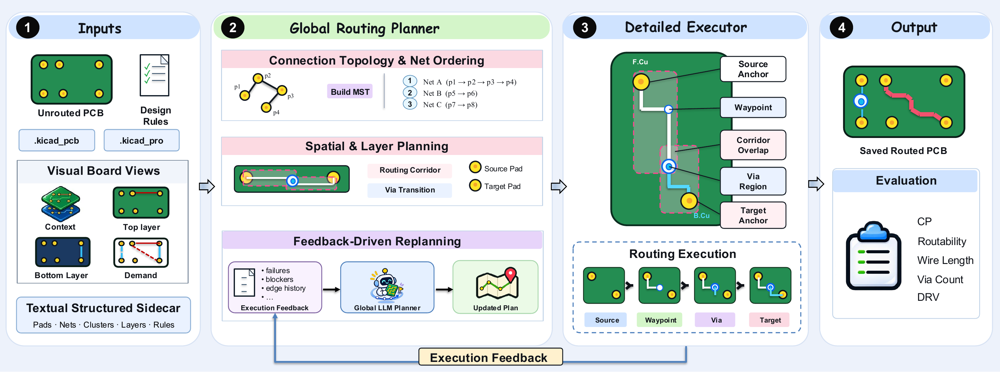

**English** | [简体中文](README_zh.md)

# [PCBRouteAgent: How Close Are LLM Agents to Becoming PCB Routing Engineers?](https://arxiv.org/abs/2611.08175)

[](https://arxiv.org/abs/2611.08175)
[](LICENSE)

Yue Zhang, Jilei Sun, Liqiang Jing, Yijie Wei, Ruohan Yang

Official code for the paper. [Paper](https://arxiv.org/abs/2611.08175) | [Project page](https://chip-ai-agent.github.io/research/pcbrouteagent)

## Method

<p align="center"></p>

PCBRouteAgent is a multimodal agentic framework for PCB routing that integrates two tightly coupled
components: a Global Routing Planner and a Detailed Routing Executor. The Global Routing Planner takes
on the board-level planning responsibilities of a human PCB routing engineer, developing and
maintaining a high-level routing strategy that covers key decisions such as connectivity planning,
routing priorities, and spatial and layer planning. Guided by this strategy, the Detailed Routing
Executor establishes physical connections through KiCad's native push-and-shove (PNS) router while
handling local obstacles and geometric constraints, generating structured execution feedback when
routing attempts fail. The Global Routing Planner then leverages this feedback and multimodal board
context to revise its strategy and guide subsequent execution, enabling the agent to iteratively adapt
its routing decisions.

## Installation

PCBRouteAgent runs on [PCBWorld](https://github.com/LGAI-Research/PCBWorld), included as a submodule.

```bash
git clone --recurse-submodules https://github.com/chip-ai-agent/PCBRouteAgent.git && cd PCBRouteAgent

# 1. Build PCBWorld (see third_party/PCBWorld/docs/QUICKSTART.md):
(cd third_party/PCBWorld && bash tools/setup/setup_all.sh)
conda activate pcbworld

# 2. Prepare the PCBWorld-Bench test splits with PCBWorld's tooling and set their location:
export PCBWORLD_DATA_ROOT=/path/to/datasets

# 3. Install PCBRouteAgent and add your API key:
pip install -e ".[llm]"
mkdir -p ~/.config/routeagent && cp .env.example ~/.config/routeagent/env && chmod 600 ~/.config/routeagent/env

python -m route_agent.cli.pipeline status --probe
```

To use an existing PCBWorld checkout, set `PCBWORLD_ROOT=/path/to/PCBWorld`.

## Run

```bash
scripts/run_pcbworld.sh -m claude-opus-5-5                # D2, D3-A, D3-B and D3-C
scripts/run_pcbworld.sh -m claude-haiku-5-5 -s d3b        # one split
scripts/run_pcbworld.sh -m claude-opus-5-5 -s "d3b d3c"   # several splits
```

The script routes every board of the chosen splits, scores each saved board with PCBWorld's
official evaluator and prints the result table. Options: `-o DIR` output directory (default
`runs/<timestamp>-<model>`), `-n` dry run, arguments after `--` go to `benchset`.

One split or one board directly:

```bash
python -m route_agent.cli.pipeline benchset --list configs/board_lists/d3b_test.txt \
    --out runs/d3b --provider anthropic --model claude-opus-5-5

python -m route_agent.cli.pipeline bench BOARD_unrouted.kicad_pcb --out runs/one \
    --provider anthropic --model claude-opus-5-5 --reward-config drc_dense_errors_only_eval
```

## Evaluate

```bash
python scripts/summarize.py runs/<run>                    # result table of a finished run
python -m route_agent.cli.pipeline score runs/one/routed.kicad_pcb --reward-config drc_dense_errors_only_eval
```

## Citation

```bibtex
@misc{zhang2026pcbrouteagentclosellmagents,
      title={PCBRouteAgent: How Close Are LLM Agents to Becoming PCB Routing Engineers?},
      author={Yue Zhang and Jilei Sun and Liqiang Jing and Yijie Wei and Ruohan Yang},
      year={2026},
      eprint={2611.08175},
      archivePrefix={arXiv},
      primaryClass={cs.AI},
      url={https://arxiv.org/abs/2611.08175},
}
```

## License

BSD 3-Clause, the same license as PCBWorld. See [LICENSE](LICENSE) and [NOTICE.md](NOTICE.md).
