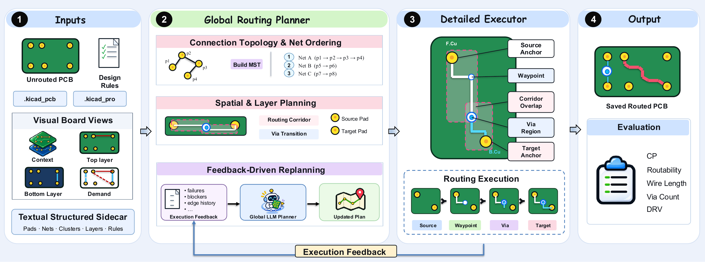

[English](README.md) | **简体中文**

# [PCBRouteAgent: How Close Are LLM Agents to Becoming PCB Routing Engineers?](https://arxiv.org/abs/2611.08175)

[](https://arxiv.org/abs/2611.08175)
[](LICENSE)

Yue Zhang, Jilei Sun, Liqiang Jing, Yijie Wei, Ruohan Yang

论文的官方代码。[论文](https://arxiv.org/abs/2611.08175) | [项目主页](https://chip-ai-agent.github.io/research/pcbrouteagent)

## 方法

<p align="center"></p>

PCBRouteAgent 是一个面向 PCB 布线的多模态 agent 框架，由两个紧密耦合的组件构成：Global Routing Planner（全局布线规划器）
和 Detailed Routing Executor（详细布线执行器）。Global Routing Planner 承担人类 PCB 布线工程师在板级层面的规划职责，
制定并维护高层布线策略，涵盖连接规划、布线优先级以及空间与层规划等关键决策。在该策略的引导下，Detailed Routing Executor
通过 KiCad 原生的推挤（PNS）布线器建立物理连接，同时处理局部障碍和几何约束，并在布线尝试失败时生成结构化的执行反馈。
随后 Global Routing Planner 利用这些反馈和多模态的板上下文修订策略、引导后续执行，使 agent 能够迭代地调整布线决策。

## 安装

PCBRouteAgent 运行在 [PCBWorld](https://github.com/LGAI-Research/PCBWorld) 之上，PCBWorld 以 submodule 形式包含在本仓库中。

```bash
git clone --recurse-submodules https://github.com/chip-ai-agent/PCBRouteAgent.git && cd PCBRouteAgent

# 1. 编译 PCBWorld（见 third_party/PCBWorld/docs/QUICKSTART.md）：
(cd third_party/PCBWorld && bash tools/setup/setup_all.sh)
conda activate pcbworld

# 2. 用 PCBWorld 的工具准备 PCBWorld-Bench 测试划分，并设置数据位置：
export PCBWORLD_DATA_ROOT=/path/to/datasets

# 3. 安装 PCBRouteAgent 并填入 API key：
pip install -e ".[llm]"
mkdir -p ~/.config/routeagent && cp .env.example ~/.config/routeagent/env && chmod 600 ~/.config/routeagent/env

python -m route_agent.cli.pipeline status --probe
```

如果要使用已有的 PCBWorld，设置 `PCBWORLD_ROOT=/path/to/PCBWorld`。

## 运行

```bash
scripts/run_pcbworld.sh -m claude-opus-5-5                # D2、D3-A、D3-B、D3-C
scripts/run_pcbworld.sh -m claude-haiku-5-5 -s d3b        # 一个划分
scripts/run_pcbworld.sh -m claude-opus-5-5 -s "d3b d3c"   # 多个划分
```

脚本会布完所选划分的每一块板，用 PCBWorld 官方评估器给每块保存的板打分，并打印结果表。选项：`-o DIR` 指定输出目录
（默认 `runs/<时间戳>-<模型>`），`-n` 只打印命令不执行，`--` 之后的参数传给 `benchset`。

直接运行一个划分或一块板：

```bash
python -m route_agent.cli.pipeline benchset --list configs/board_lists/d3b_test.txt \
    --out runs/d3b --provider anthropic --model claude-opus-5-5

python -m route_agent.cli.pipeline bench BOARD_unrouted.kicad_pcb --out runs/one \
    --provider anthropic --model claude-opus-5-5 --reward-config drc_dense_errors_only_eval
```

## 评估

```bash
python scripts/summarize.py runs/<run>                    # 打印某次运行的结果表
python -m route_agent.cli.pipeline score runs/one/routed.kicad_pcb --reward-config drc_dense_errors_only_eval
```

## 引用

```bibtex
@misc{zhang2026pcbrouteagentclosellmagents,
      title={PCBRouteAgent: How Close Are LLM Agents to Becoming PCB Routing Engineers?},
      author={Yue Zhang and Jilei Sun and Liqiang Jing and Yijie Wei and Ruohan Yang},
      year={2026},
      eprint={2611.08175},
      archivePrefix={arXiv},
      primaryClass={cs.AI},
      url={https://arxiv.org/abs/2611.08175},
}
```

## 许可证

BSD 3-Clause，与 PCBWorld 相同。见 [LICENSE](LICENSE) 和 [NOTICE.md](NOTICE.md)。
